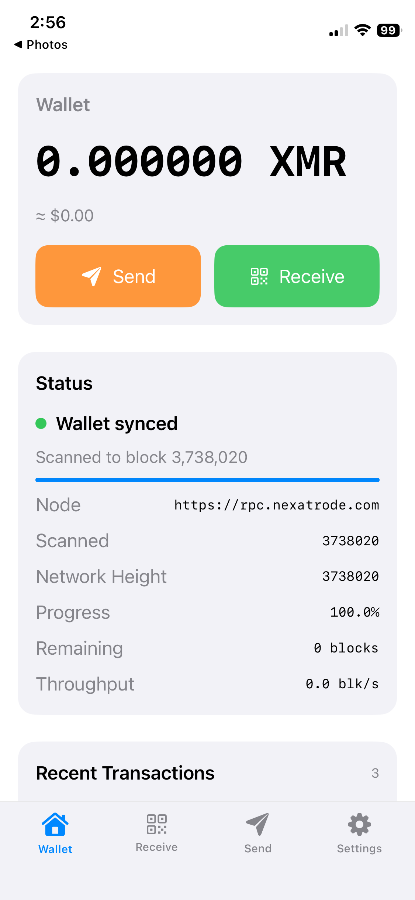
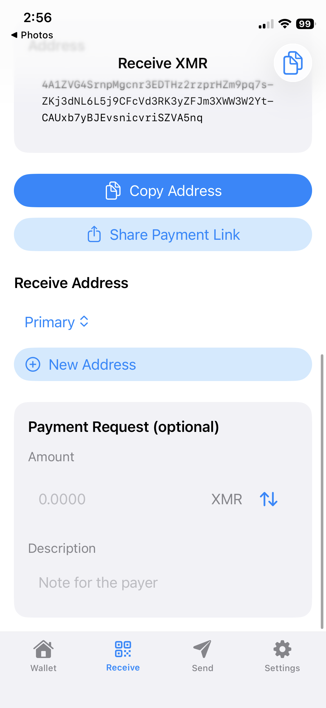
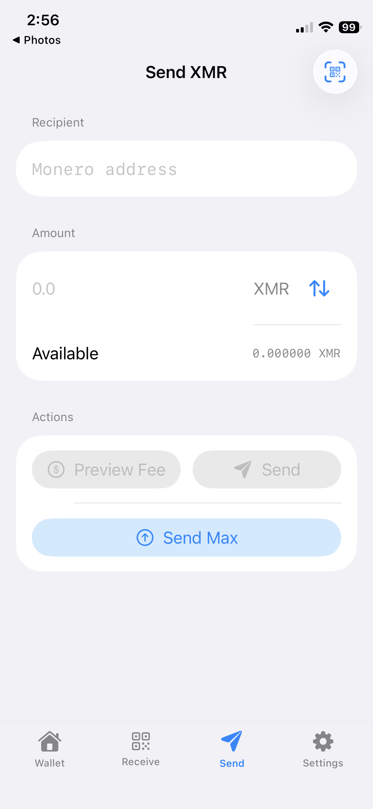
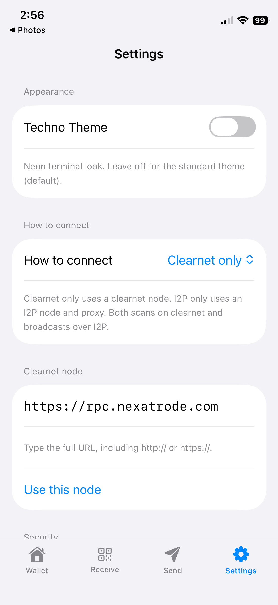
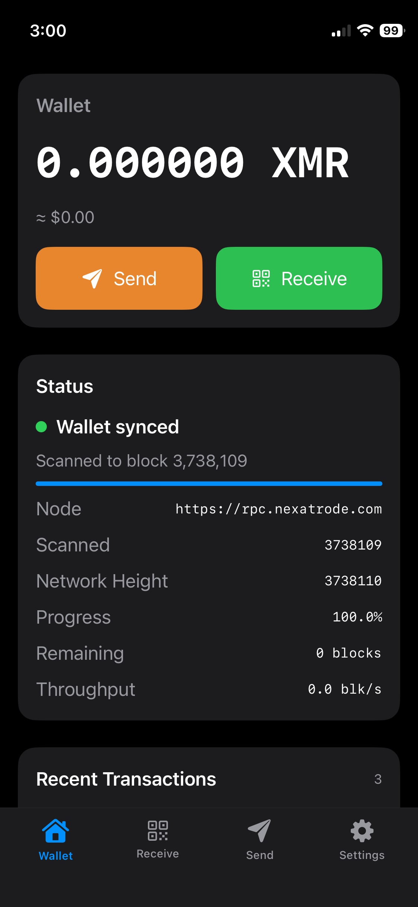
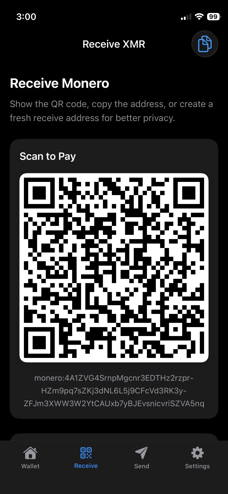
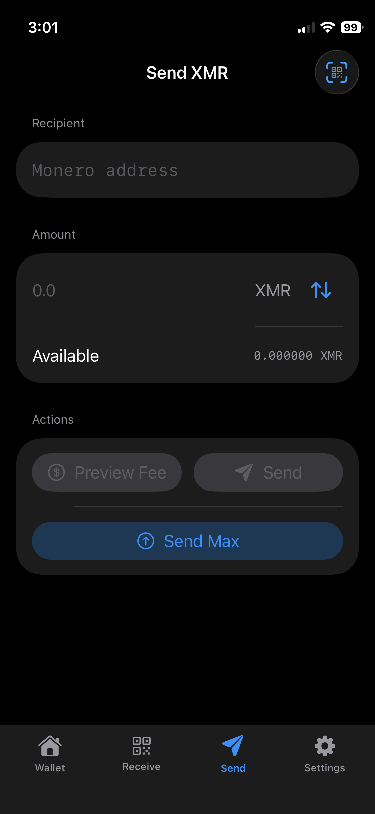
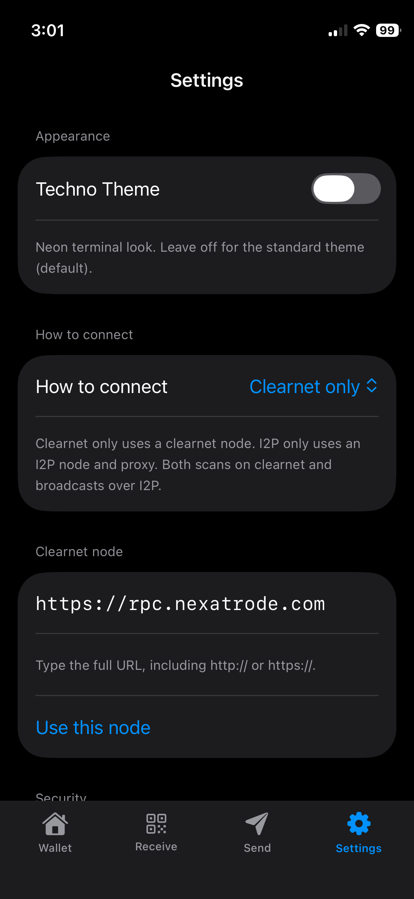

# nexawal

`nexawal` is an iOS Monero wallet built on top of `monero-oxide` and the `MoneroWalletCoreFFI` layer.

- iOS / Mac Catalyst app: this repository
- Android app: [nexawal-android](https://github.com/Nexatrode/nexawal-android)
- Desktop (macOS, Windows, Linux): [nexawal-gpui](https://github.com/Nexatrode/nexawal-gpui)
- Shared wallet core (SPM): [MoneroWalletCoreFFI](https://github.com/cacaosteve/MoneroWalletCoreFFI) pinned to `c5430e9` (WalletCore 0.1.19)
- Monero library work: [monero-oxide](https://github.com/cacaosteve/monero-oxide) (fork pin used by the core)
- Website: [nexatrode.com](https://nexatrode.com)

## Setup

```bash
git clone https://github.com/Nexatrode/nexawal.git
cd nexawal
open nexawal.xcodeproj
```

Xcode resolves `MoneroWalletCoreFFI` at the release-candidate revision recorded in the project (prebuilt XCFramework — no Rust required). Update the revision deliberately when cutting a new release.

## Screenshots

### Light

| Wallet | Receive |
| --- | --- |
|  |  |

| Send | Settings |
| --- | --- |
|  |  |

### Dark

| Wallet | Receive |
| --- | --- |
|  |  |

| Send | Settings |
| --- | --- |
|  |  |

## Features

- Single-wallet Monero app (create or import)
- Create-flow seed backup gate (write-down confirmation + word check) before the wallet is persisted
- Optional Face ID / Touch ID for unlock and send
- Techno Theme toggle (on = neon terminal look; off/default = standard look)
- Clearnet / I2P / hybrid node routing
- Sync status with honest tip/scanned progress; node errors surface when refresh fails
- Receive: QR, copy address, copy payment URI when an amount is set, subaddresses
- Send / send-max with fee preview; prepare → durable persist → relay under the hood
- Transaction details with copy txid and optional explorer link

## Adaptive layout testing

- Send/Receive drafts are memory-only and belong to the unlocked session, not to
  the current tab/sidebar layout. Locking, replacing the wallet, or resetting its
  history session discards them. Fee approvals and in-flight sends are not drafts.
- On iOS 27.1+, one native adaptive tab container remains attached while resizing.
  Forms and the QR scanner avoid active division regions, including hinge margins.
  Earlier iPhone/iPad layouts keep their existing tab/sidebar presentation.
- Run `swift test --package-path Packages/NexaWalLogic` for geometry/input regressions.
- For visual QA, launch a **Debug simulator** build with `--ui-layout-regression`.
  This fixture renders the real forms without loading a stored wallet or accepting
  terms. Its Test controls menu switches tabs/themes and starts a fresh test session.
  The fixture is excluded from Release and physical-device builds.
- Enter harmless, invalid destination text and separate Send/Receive amounts/notes.
  Switch tabs, fold/unfold, rotate, and cancel an open scanner; verify the drafts
  survive. Verify New test session clears both drafts. Repeat on ordinary iPhone and
  iPad layouts, including keyboard-visible and large-text states. Simulator camera
  placeholders use the real scanner overlay; live QR capture still needs a device.

## Notes

Connection edits are validated before any active preferences change. Rejected
edits retain the saved routing mode and do not reconnect. Both node configuration
cards stay available so an inactive route can be prepared before switching modes.
Run `bash scripts/test-connection-settings.sh` for host tests of the actual settings
code, without opening a wallet or the Keychain.

- Uses a native wallet core built from `monero-oxide` via `MoneroWalletCoreFFI`
- Syncs against standard Monero nodes (local or remote), including the configured I2P RPC path when enabled
- Default daemon is `https://rpc.nexawal.com` (type a full `http://` or `https://` URL to override)
- Feature parity targets: [nexawal-android](https://github.com/Nexatrode/nexawal-android) and [nexawal-gpui](https://github.com/Nexatrode/nexawal-gpui)
- Unaudited software. You are responsible for backups and funds. A remote node can see your IP and sync queries.

The previous built-in RPC preference migrates to the current default. Custom
nodes and I2P settings remain unchanged. Optional rates use
`https://rates.nexawal.com` over clearnet HTTPS.

## Privacy

See [docs/PRIVACY.md](docs/PRIVACY.md) (bundled offline in the app under Settings → Privacy policy). App Store listings can still use the HTTPS URL on nexatrode.com if required by the store form.

## Terms

See [docs/TERMS.md](docs/TERMS.md) (bundled offline in the app).

## License

[MIT](LICENSE). Downstream code such as `monero-oxide` remains under its own MIT terms; keep those notices when you redistribute.
